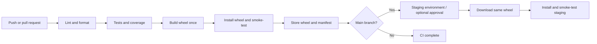

# CI/CD wheel workshop

A small Python project for teaching CI/CD with **GitHub Actions** and **Azure DevOps**.
Both pipelines test the same app, build a deployable **`.whl`**, and install that exact
wheel into a fresh staging environment. No cloud account, runtime dependencies, or
deployment secrets are needed for the default exercise.

The app calculates shipping: 500 cents below a 5000-cent order, free shipping at or
above 5000 cents. Those boundaries make regressions easy to introduce and understand.



**The default staging environment is a sandbox on a hosted pipeline agent.** Its
server runs during the smoke test, then stops; its files disappear when the job ends.
The pipeline does not publish a public website. Use the local wheel installation or
Docker instructions below to keep the app running while you experiment.

## Why these steps matter

| Step | What learners see | Why it helps |
| --- | --- | --- |
| Lint and format | A consistent, automated code check | Finds common mistakes early and keeps reviews focused |
| Tests | A broken boundary fails before release | Gives fast feedback and reduces regressions |
| Coverage gate | Less than 85% coverage fails CI | Shows which paths need tests; coverage alone does not prove correctness |
| Build wheel | Code and packaged resources become one installable file | Removes manual source-copying from deployment |
| Install and smoke-test wheel | The packaged app runs away from the checkout | Catches missing files and installation problems that source tests can miss |
| Store artifact | A version, commit and SHA-256 checksum identify the release | Makes promotion and rollback traceable |
| Staging gate | Only successful main-branch builds deploy | Separates proposed changes from releases |

**Continuous integration (CI)** checks changes automatically. **Continuous delivery**
keeps a tested release ready for approval. **Continuous deployment** releases it
automatically after checks pass. This starter deploys automatically to its staging
sandbox; adding an environment approval lets you demonstrate delivery with a human gate.

## Run locally

Use Python **3.13**, Git, and a terminal. The app declares Python 3.11+ support;
the starting pipelines test 3.13. Docker is optional. Run commands from this repository.
The initial dependency installation and wheel build need internet access.

PowerShell on Windows (no virtual environment activation required):

```powershell
py -3.13 -m venv .venv
.\.venv\Scripts\python.exe -m pip install -r requirements-dev.txt
.\.venv\Scripts\python.exe -m pip install --no-build-isolation -e .
.\.venv\Scripts\python.exe -m cicd_demo --port 8000
```

macOS / Linux:

```bash
python3.13 -m venv .venv
.venv/bin/python -m pip install -r requirements-dev.txt
.venv/bin/python -m pip install --no-build-isolation -e .
.venv/bin/python -m cicd_demo --port 8000
```

Open <http://127.0.0.1:8000>. Stop the server with **Ctrl+C**. The useful endpoints are:

| Request | Expected result |
| --- | --- |
| `GET /health` | `{"status": "ok", "version": "0.1.0"}` initially |
| `GET /api/quote?subtotal_cents=4999` | 500 cents shipping; total 5499 |
| `GET /api/quote?subtotal_cents=5000` | Free shipping; total 5000 |
| `GET /api/quote?subtotal_cents=-1` | HTTP 400 |
| `GET /missing` | HTTP 404 |

The HTTP server is a small teaching server, not a production web-server configuration.

## Test, build, and deploy the wheel

On Windows:

```powershell
.\.venv\Scripts\python.exe -m ruff check .
.\.venv\Scripts\python.exe -m ruff format --check .
.\.venv\Scripts\python.exe -m pytest --cov --cov-report=term-missing --cov-report=xml:coverage.xml --junitxml=test-results/junit.xml
.\.venv\Scripts\python.exe scripts/release.py build
.\.venv\Scripts\python.exe scripts/release.py verify
.\.venv\Scripts\python.exe scripts/release.py deploy --artifact-dir dist --target .deploy/staging-1
.\.deploy\staging-1\Scripts\python.exe -I -m cicd_demo --port 8000
```

On macOS / Linux, use `.venv/bin/python` for the first six commands and
`.deploy/staging-1/bin/python -I -m cicd_demo --port 8000` for the last command.

`dist/` contains the wheel and `release.json`. The manifest records the wheel filename,
package version, source commit, and checksum. A local build without a commit records
`uncommitted`; local edits are not tracked separately in the manifest. CI records the
commit it checks out. The checksum detects a changed wheel; it is not an authenticity signature.

The deployment command verifies the manifest, creates a fresh virtual environment,
installs the wheel **without network access or dependencies**, starts the installed app
in an isolated working directory, checks its endpoints, and stops the smoke-test server.
A successful installation writes `installed-release.json` inside the target directory.
The final command above starts that installed app for you to use.

Rebuilding replaces generated wheels and the manifest in the chosen output directory.
Use `build --output-dir dist-v2` to keep a separate release. Deployment refuses to
overwrite an existing environment: use a fresh target such as `.deploy/staging-2`.
An interrupted or failed deployment can leave its directory behind; select a new target
and inspect the failure before trying again. `-I` prevents the checkout or `PYTHONPATH`
from hiding packaging mistakes. Source tests use an editable install; release tests use the wheel.
The builder uses a temporary source distribution to build the wheel in a clean
directory, so stale local build files cannot conceal a packaging mistake. Only the
wheel and manifest are promoted.

## Run the same wheel in Docker

Build the wheel first. With Docker running, use your development Python executable
for the verification and smoke-test commands (`.venv/bin/python` on macOS / Linux):

```powershell
.\.venv\Scripts\python.exe scripts/release.py verify
docker build -t cicd-demo:0.1.0 .
docker run --detach --name cicd-demo --publish 127.0.0.1:8000:8000 cicd-demo:0.1.0
.\.venv\Scripts\python.exe scripts/smoke_test.py --url http://127.0.0.1:8000 --expected-version 0.1.0
docker logs cicd-demo
```

The image installs the existing wheel; application source stays outside the build
context. Wait for the container to start before running the smoke test. Stop any local
server using port 8000 first. Clean up with `docker rm --force cicd-demo`.
After changing the package version, change the image tag and expected version too.

## Start the pipelines and workshop

- [Pipeline setup and platform comparison](docs/PIPELINES.md): GitHub, Azure DevOps, approvals, and troubleshooting.
- [Hands-on labs](docs/WORKSHOP.md): break/fix CI, packaging, release promotion, approvals, and rollback.
- [Instructor guide](docs/INSTRUCTOR.md): a suggested session, checkpoints, and discussion questions.


| File | Purpose |
| --- | --- |
| `src/cicd_demo/shipping.py` | Small business rules to change |
| `src/cicd_demo/server.py` | HTTP endpoints and CLI |
| `tests/` | Business rules, API behavior, and release integrity checks |
| `pyproject.toml` | Package version, wheel contents, quality settings |
| `scripts/release.py` | Shared build, verify, and staging installation commands |
| `scripts/smoke_test.py` | Test a wheel installation or a running container |
| `.github/workflows/ci-cd.yml` | GitHub Actions workflow |
| `azure-pipelines.yml` | Azure DevOps pipeline |
| `Dockerfile` | Optional deployment of the existing wheel |
